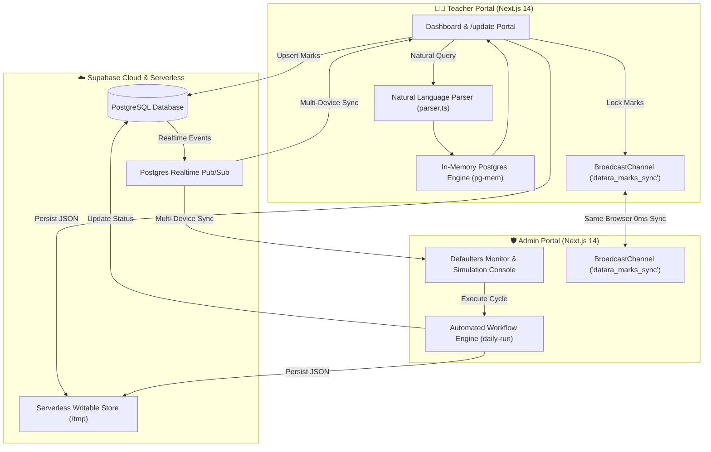

# 🎓 Datara — Real-Time Academic Intelligence & Defaulter Management Platform

<div align="center">


<p align="center">
  <b>A dual-portal institutional system engineered for MIT World Peace University (MIT-WPU)</b><br>
  Empowering faculty with offline natural language SQL queries, real-time marks entry & locking, and automated multi-phase defaulter detection workflows.
</p>

[🌐 Live Teacher Portal](https://datara-for-teachers.vercel.app) &nbsp;•&nbsp; [🛡️ Live Admin Portal](https://datara-for-admin.vercel.app)

</div>

---

## 📌 Table of Contents
- [✨ Core Capabilities](#-core-capabilities)
  - [🧑‍🏫 Teacher Portal](#1-teacher-portal-teacher)
  - [🛡️ Admin Portal](#2-admin-portal-admin)
- [🔄 Academic Evaluation & LCA Lifecycle Rules](#-academic-evaluation--lca-lifecycle-rules)
- [🏗️ System Architecture & Real-Time Data Pipeline](#️-system-architecture--real-time-data-pipeline)
- [🚀 Quick Start & Local Setup](#-quick-start--local-setup)
- [🔐 Default Credentials](#-default-credentials)
- [🗄️ Supabase PostgreSQL Setup & Realtime Replication](#️-supabase-postgresql-setup--realtime-replication)
- [💬 Natural Language Query Engine](#-natural-language-query-engine)
- [📊 Intelligent Data Export Engine](#-intelligent-data-export-engine)
- [🛡️ Security & Role-Based Access Control (RBAC)](#️-security--role-based-access-control-rbac)

---

## ✨ Core Capabilities

### 1. 🧑‍🏫 Teacher Portal (`/teacher`)
* **🧠 Natural Language Query Engine**: Translate colloquial teacher prompts (e.g. *"students in panel D with attendance < 80%"*, *"show cca2 marks of panel E"*, *"girls in panel J"*) into validated PostgreSQL queries running on an in-memory SQL engine (`pg-mem`).
* **✍️ Add / Update Marks Workspace (`/update`)**:
  * Dynamic live editable spreadsheet for CCA-1 (/15), CCA-2 (/15), Midterm (/30), LCA-1 (/33), LCA-2 (/33), and LCA-3 (/34).
  * Lock / Unlock security gates preventing unintended alterations.
  * Instant automatic recalculation of internal aggregate scores (/60).
  * **0ms Latency Live Sync**: Instant propagation of marks changes across browser tabs and devices via `BroadcastChannel` and Supabase Realtime without requiring a page refresh.
* **✉️ Dynamic Defaulter Email Dispatcher**:
  * Real-time in-line editable email preview with zero save friction.
  * One-click bulk dispatch with automated parameter interpolation (`{name}`, `{roll_no}`, `{attendance}`, `{marks}`).
  * Live dispatch feed tracking the latest 20 notifications with delivered receipt stamps.
* **📑 Filtered Export Suite**:
  * Native Microsoft Excel (`.xlsx`) workbooks and formatted printable PDFs (`.pdf`).
  * **Strict Query Filtering**: Exclusively exports the specific attributes requested by the user's query, omitting internal identifiers and unqueried fields.

---

### 2. 🛡️ Admin Portal (`/admin`)
* **👥 Students Defaulters Monitor & Live Directory**:
  * Instant category-based filtering:
    * ⚠️ **Attendance Defaulters**: Real-time flag for students below the mandatory 80.0% threshold.
    * 📉 **Marks Defaulters**: Flagged when internal evaluation aggregate (CCA1 + CCA2 + Midterm) falls below 24/60.
    * ⏳ **LCA Incomplete / Expired**: Monitors 10-day evaluation windows and 4-day buffer statuses.
    * 🚫 **Detained Roster**: Official record of students debarred from term-end examinations.
* **⚡ Daily Automation Cycle Runner**:
  * Step simulation forward by 1 day (`⚡ Run Daily Cycle (+1 Day)`) to execute university-wide attendance audits, marks warnings, LCA countdown decrements, and automated buffer escalations.
  * Full simulation state reset (`↺ Reset to Day 1`).
* **🔑 Role-Based Access Matrix & Instant Revocation**:
  * Configure allowed cohort panels (Panels A through K), academic years (TY), and departments (CSE) per faculty member.
  * Instant account toggle with instantaneous push notification deactivating query privileges in real-time.

---

## 🔄 Academic Evaluation & LCA Lifecycle Rules

Datara codifies MIT-WPU academic governance policies into an automated daily evaluation state machine:

| Evaluation Stage | Benchmark / Trigger | Automated System Action | Notice Dispatched |
| :--- | :--- | :--- | :--- |
| **Attendance Check** | Attendance `< 80.0%` | Daily flag in Defaulters Directory | Automated Daily Attendance Alert |
| **Internal Marks Check** | `CCA1 + CCA2 + Midterm < 24/60` | Flagged as Academic Deficiency Defaulter | Automated Academic Remedial Warning |
| **LCA Window (Days 1–9)** | Unrecorded LCA assessment | Countdown decrements by 1 day per cycle | Periodic LCA Reminder |
| **LCA Final Day (Day 10)** | Final day of 10-day window | Grace warning before buffer phase | Urgent Final Day Notice |
| **LCA Buffer Phase (Days 1–3)** | 4-Day emergency buffer | Buffer countdown decrements daily | Critical Final Buffer Warning |
| **Buffer Expiry (Day 4)** | Buffer window reaches 0 | **Marks permanently set to `0`** | Score Assignment Notice |
| **Debarment / Detention (Day 5)** | Continued non-appearance | **Status updated to `Detained = true`** | Official Academic Debarment Notice |

---

## 🏗️ System Architecture & Real-Time Data Pipeline



---

## 🚀 Quick Start & Local Setup

### 📋 Prerequisites
- **Node.js**: `v18.17.0` or higher
- **npm**: `v9.0.0` or higher
- **Git**

### 1. Clone & Install Dependencies
```bash
git clone https://github.com/parthjod/Datara.git
cd Datara

# Install dependencies across all portals:
npm run install:all
```

### 2. Configure Environment Variables

Create `.env.local` inside `teacher/`:
```env
NEXT_PUBLIC_APP_NAME=Datara
NEXT_PUBLIC_INSTITUTE_DOMAIN=mitwpu.edu.in
NEXT_PUBLIC_TEACHER_EMAIL=teacher@mitwpu.edu.in
NEXT_PUBLIC_TEACHER_PASSWORD=teacher123
NEXT_PUBLIC_SUPABASE_URL=https://rjvawvgruusxrusizgmy.supabase.co
NEXT_PUBLIC_SUPABASE_ANON_KEY=eyJhbGciOiJIUzI1NiIsInR5cCI6IkpXVCJ9...
```

Create `.env.local` inside `admin/`:
```env
NEXT_PUBLIC_APP_NAME=Datara
NEXT_PUBLIC_INSTITUTE_DOMAIN=mitwpu.edu.in
NEXT_PUBLIC_ADMIN_EMAIL=admin@mitwpu.edu.in
NEXT_PUBLIC_ADMIN_PASSWORD=admin
NEXT_PUBLIC_SUPABASE_URL=https://rjvawvgruusxrusizgmy.supabase.co
NEXT_PUBLIC_SUPABASE_ANON_KEY=eyJhbGciOiJIUzI1NiIsInR5cCI6IkpXVCJ9...
```

### 3. Run Development Servers
In two separate terminals:

```bash
# Terminal 1 — Teacher Portal (Port 3000)
npm run dev:teacher

# Terminal 2 — Admin Portal (Port 3001)
npm run dev:admin
```

---

## 🔐 Default Credentials

| Portal | URL | Username / Email | Password | Allowed Access |
| :--- | :--- | :--- | :--- | :--- |
| **🧑‍🏫 Teacher Portal** | `http://localhost:3000` | `teacher@mitwpu.edu.in` | `teacher123` | Cohort Panels `D` and `J` |
| **🛡️ Admin Portal** | `http://localhost:3001` | `admin@mitwpu.edu.in` | `admin` | Full Institutional Super-Admin |

---

## 🗄️ Supabase PostgreSQL Setup & Realtime Replication

To configure your own Supabase backend for persistent cloud storage and cross-browser live sync, execute this script in your **Supabase SQL Editor**:

```sql
-- 1. Create Students Database Table
CREATE TABLE IF NOT EXISTS students (
  roll_no TEXT PRIMARY KEY,
  name TEXT NOT NULL,
  email TEXT NOT NULL,
  phone TEXT,
  address TEXT,
  aadhar TEXT,
  dob TEXT,
  gender TEXT,
  department TEXT DEFAULT 'CSE',
  panel TEXT NOT NULL,
  year TEXT DEFAULT 'TY',
  program TEXT DEFAULT 'BTech',
  attendance NUMERIC DEFAULT 85.0,
  cca1 NUMERIC DEFAULT 0,
  cca2 NUMERIC DEFAULT 0,
  midterm NUMERIC DEFAULT 0,
  lca1 NUMERIC,
  lca2 NUMERIC,
  lca3 NUMERIC,
  detained BOOLEAN DEFAULT FALSE,
  lca1_days_left NUMERIC DEFAULT 10,
  lca1_buffer_left NUMERIC DEFAULT 4,
  lca1_detention_pending BOOLEAN DEFAULT FALSE,
  lca2_days_left NUMERIC DEFAULT 10,
  lca2_buffer_left NUMERIC DEFAULT 4,
  lca2_detention_pending BOOLEAN DEFAULT FALSE,
  lca3_days_left NUMERIC DEFAULT 10,
  lca3_buffer_left NUMERIC DEFAULT 4,
  lca3_detention_pending BOOLEAN DEFAULT FALSE,
  updated_at TIMESTAMPTZ DEFAULT NOW()
);

-- 2. Create Faculty Permissions Table
CREATE TABLE IF NOT EXISTS faculty_permissions (
  email TEXT PRIMARY KEY,
  panels TEXT[] NOT NULL DEFAULT '{"D", "J"}',
  years TEXT[] NOT NULL DEFAULT '{"TY"}',
  departments TEXT[] NOT NULL DEFAULT '{"CSE"}',
  active BOOLEAN DEFAULT TRUE,
  updated_at TIMESTAMPTZ DEFAULT NOW()
);

-- 3. Enable Full Realtime Replication
ALTER PUBLICATION supabase_realtime ADD TABLE students;
ALTER PUBLICATION supabase_realtime ADD TABLE faculty_permissions;
```

---

## 💬 Natural Language Query Engine

Teachers can execute natural language searches without writing SQL queries. The built-in deterministic parser converts intents into secure PostgreSQL queries:

| Natural Language Intent | Generated SQL Query | Access Control Policy |
| :--- | :--- | :--- |
| `"show students in panel D"` | `SELECT roll_no, name, email, phone, panel FROM students WHERE panel IN ('D') AND year = 'TY' AND department = 'CSE';` | ✅ Allowed (Panel D authorized) |
| `"attendance defaulters in panel J"` | `SELECT roll_no, name, attendance, email, phone, panel FROM students WHERE panel IN ('J') AND attendance < 80 ORDER BY attendance ASC;` | ✅ Allowed (Panel J authorized) |
| `"show cca2 marks of panel D"` | `SELECT roll_no, name, panel, cca2 FROM students WHERE panel IN ('D') AND year = 'TY';` | ✅ Allowed |
| `"students with aggregate < 24 in panel D"` | `SELECT roll_no, name, cca1, cca2, midterm, (cca1 + cca2 + midterm) AS aggregate, email, phone, panel FROM students WHERE panel IN ('D') AND (cca1 + cca2 + midterm) < 24;` | ✅ Allowed |
| `"show list of panel E students"` | *Blocked at API Layer* | ❌ Denied (`UnauthorizedPanelError: Panel E not assigned`) |

---

## 📊 Intelligent Data Export Engine

* **Query-Scoped Excel Export (`.xlsx`)**: Custom styled headers and auto-sized columns generated by SheetJS. If a teacher queries for CCA-2 marks, the exported spreadsheet contains only `Roll No`, `Name`, `Panel`, and `CCA 2`, automatically stripping internal database metadata.
* **Print-Optimized PDF Export (`.pdf`)**: Formatted for A4 institutional reports, complete with query context metadata, generation timestamps, student count tallies, and alternating row highlights.

---

## 🛡️ Security & Role-Based Access Control (RBAC)

1. **Strict Faculty Partitioning**: Faculty members can only query cohorts explicitly assigned to them by administrators.
2. **Instant Access Revocation**: Administrators can deactivate faculty privileges with a single toggle. The live listener revokes querying permissions within milliseconds.
3. **Serverless Safe Persistence**: Implements dual persistence with an in-memory cache, writable `/tmp` serverless storage, and Supabase cloud replication to prevent `EROFS` (read-only filesystem) errors on Vercel.

---

<div align="center">
  <b>Developed for Department of Computer Science & Engineering, MIT World Peace University</b><br>
  Made with ❤️ by Parth
</div>
